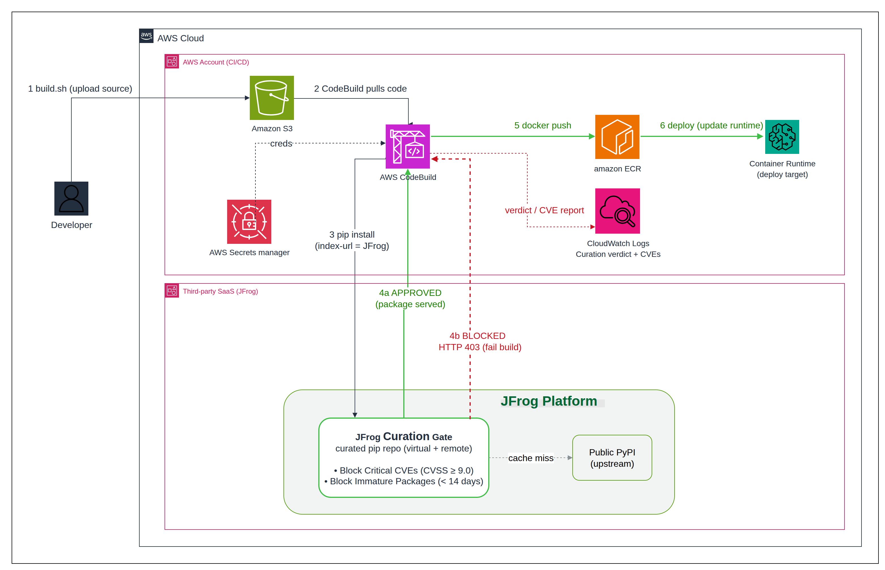

# Securing Every Dependency: JFrog Curation in an AWS CodeBuild Pipeline

A minimal, runnable companion to the blog post. It shows how to gate a
container build on **JFrog Curation** so that a package with a blocked policy
violation (a critical CVE, an immature release, a disallowed license, …) fails
the build *before* an image is ever pushed to a registry.

The security control is two things:

1. **Redirect pip** to a curated JFrog repository instead of public PyPI, so
   every `pip install` is evaluated by Curation.
2. **Gate the push** — publish the image only when the build (and therefore
   Curation) succeeded.

The sample application is intentionally trivial. The point is the pipeline.



## Repository layout

```
.
├── buildspec.yml              # CodeBuild entrypoint — wires the three phases
├── Dockerfile                 # pip install runs through the curated repo
├── requirements.txt           # happy-path deps (all pass Curation)
├── requirements-broken.txt    # blocked-path deps (pyyaml 5.3, CVE-2020-14343)
├── app.py                     # trivial sample app so the image runs
├── architecture.png/.drawio   # the diagram above (editable source)
└── scripts/
    ├── setup.sh               # pre-build: JFrog CLI, auth, pip redirect
    ├── docker-build.sh        # build: curated docker build + log capture
    └── post-build.sh          # gate: push on success, report block on failure
```

## How the gate works

`pip` is pointed at a JFrog **virtual** repo, which resolves through a
Curation-enabled **remote** repo:

- **Approved** package → served from cache (or fetched from the PyPI remote).
- **Blocked** package → JFrog returns **HTTP 403** → `pip install` fails → the
  Docker `RUN` layer fails → the build fails → the image is never pushed.

On a block, `post-build.sh` reads the failing package out of the build log and
queries JFrog to explain *why* it was blocked (policy, condition, CVE IDs),
then exits non-zero.

## Prerequisites

**JFrog Platform**
- A PyPI **virtual** repo (e.g. `curated-pypi`) aggregating a **remote** repo
  that proxies `pypi.org`.
- **Curation enabled** on the remote repo, with at least one policy — e.g.
  "Block Critical CVEs (CVSS ≥ 9.0)" and/or "Block Immature Packages".
- (For CVE detail in the failure report) **"Pass-through for Curation audit"**
  enabled on the remote repo, so `jf curation-audit` can analyze a blocked
  package without persisting it.
- An **access token** with permission to resolve from the repo and read the
  Curation audit API.

**AWS**
- An **Amazon ECR** repository for the output image.
- An **AWS CodeBuild** project (Linux, privileged mode for Docker) with an IAM
  role allowing: `ecr:GetAuthorizationToken`, push/pull to your ECR repo, and
  `secretsmanager:GetSecretValue` for the JFrog secret.
- An **AWS Secrets Manager** secret holding the JFrog token, with keys
  `username` and `access_token`.

## Configure

Set these in `buildspec.yml` (or as CodeBuild environment variables):

| Variable | Meaning | Example |
|---|---|---|
| `JFROG_HOST` | Your JFrog host | `yourcompany.jfrog.io` |
| `JFROG_REPO` | Curated virtual pip repo | `curated-pypi` |
| `AWS_DEFAULT_REGION` | Region of ECR + CodeBuild | `us-east-1` |
| `ECR_REPO` | Target ECR repo name | `curated-sample` |
| `IMAGE_TAG` | Image tag (override per build) | `latest` |

And point the `secrets-manager` block at your secret:

```yaml
secrets-manager:
  JFROG_USER:  "your-secret-name:username"
  JFROG_TOKEN: "your-secret-name:access_token"
```

## Run it

### Happy path (build passes)

Push this repo to the source your CodeBuild project reads (CodeCommit, GitHub,
or an S3 zip) and start a build. With the default `requirements.txt`, every
dependency is approved and you should see:

```
DOCKER BUILD SUCCESSFUL
ALL DEPENDENCIES APPROVED BY JFROG CURATION
...
PUSH SUCCESSFUL
```

The image lands in ECR.

### Blocked path (build fails at the gate)

Swap in the vulnerable manifest and start another build:

```bash
cp requirements-broken.txt requirements.txt
```

`pyyaml==5.3` (CVE-2020-14343, CVSS 9.8) trips a "Block Critical CVEs" policy.
JFrog returns 403, the build fails, and `post-build.sh` reports the reason:

```
============================================
BLOCKED BY JFROG CURATION
============================================
  Package: pyyaml==5.3
  Policy:    Block Critical CVEs
  Condition: CVE with CVSS score of 9 or above
  Category:  security
  ...
============================================
PIPELINE FAILED — SKIPPING REGISTRY PUSH
============================================
```

No image is pushed. Restore `requirements.txt` to go back to the happy path.

> Adjust the blocked example to match your Curation policies. If you use an
> "immature package" policy instead, pin a package version released within your
> policy window to trigger the block.

## Build locally (optional)

The Dockerfile builds without the JFrog args too (it falls back to public
PyPI), so you can smoke-test the app image without the full pipeline:

```bash
docker build -t curated-sample .
docker run --rm -p 8080:8080 curated-sample
# GET http://localhost:8080/  ->  {"status":"ok",...}
```

The app binds to `0.0.0.0` by default so the published container port is
reachable. Override the bind address or port with the `APP_HOST` / `APP_PORT`
environment variables (e.g. `APP_HOST=127.0.0.1` for a loopback-only bind).

Note: a plain local build does **not** go through Curation — that gate only
applies when the build runs with `PIP_INDEX_URL` pointed at JFrog, as it is in
CI.

## Notes

- `buildspec.yml` sets `shell: bash` on purpose. The build reads
  `${PIPESTATUS[0]}` to get the real build exit code through the `tee` pipe;
  CodeBuild's default `sh` does not support `PIPESTATUS`.
- Each phase script runs in its own subshell, so `setup.sh` writes derived
  values (`PIP_PROXY`, `ECR_URI`) to `/tmp/build-env.sh`, which the later
  scripts `source`.
- All names here are placeholders. Nothing in this sample is tied to a
  specific account, host, or application.
- The base image is pulled from **ECR Public**
  (`public.ecr.aws/docker/library/python:3.11-slim`) rather than Docker Hub, so
  the build does not depend on an external registry. Note this is separate from
  the pip dependency flow: application packages (`requirements.txt`) are still
  resolved through the curated JFrog repo — that is the Curation gate the sample
  demonstrates.

## Security

See [CONTRIBUTING](CONTRIBUTING.md#security-issue-notifications) for more
information.

## License

This library is licensed under the MIT-0 License. See the [LICENSE](LICENSE)
file.
